# ARC Prize 2026 Paper: Holographic Outcome Memory

     

[**Question**](#research-question-and-objective) · [**Evidence**](#measured-evidence-and-baselines) · [**Limitations**](#experimental-controls-and-limitations) · [**Paper**](paper/WRITEUP.md) · [**Result tables**](tables/arc3_summary.json) · [**Provenance**](PROVENANCE.md) · [**Code (arc3-chimera-explorer)**](https://github.com/Agnuxo1/arc3-chimera-explorer)

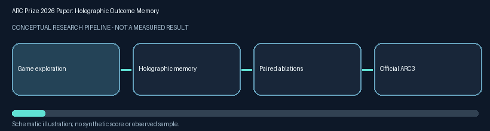

Conceptual architecture illustration only. No figure frame is an experimental recording or a measured score. [Static alternative](assets/workflow.png) and [regeneration source](scripts/generate_workflow_visual.py).

**Competition:** https://arcprize.org/competitions/2026/paper

**Status:** PAPER DRAFT: official Kaggle Paper Track entry NOT verified

**Contents** — [Research question and objective](#research-question-and-objective) · [Background](#background) · [Architecture and hypothesis](#architecture-and-hypothesis) · [Measured evidence and baselines](#measured-evidence-and-baselines) · [Reproducibility and source provenance](#reproducibility-and-source-provenance) · [Experimental controls and limitations](#experimental-controls-and-limitations) · [Real-world applications](#real-world-applications) · [Possible improvements](#possible-improvements) · [Future work](#future-work) · [Licenses, references, and AI use](#licenses-references-and-ai-use) · [Full scientific manuscript](#full-scientific-manuscript) · [Bibliography](#bibliography)

## Research question and objective

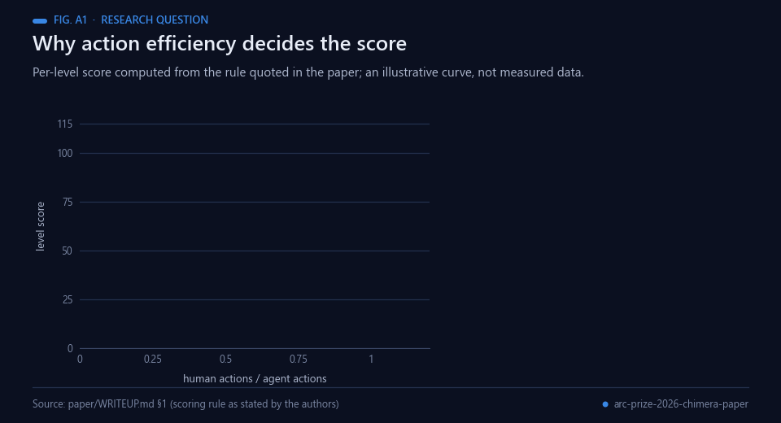 Animated figure A1 — The scoring rule quoted in paper §1, drawn as a curve. Illustrative, not measured data.

Examine whether compact local associative memory improves action ordering during interactive ARC-AGI-3 exploration.

## Background

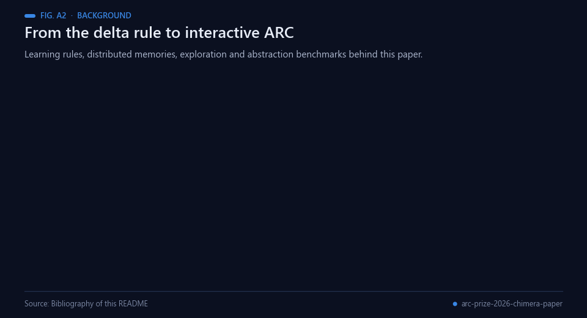 Animated figure A2 — Ideas this paper builds on. Sources: the bibliography below.

The benchmark comes from Chollet's argument that intelligence should be measured as skill-acquisition
efficiency over a scope of tasks, accounting for priors and experience, which he made concrete in the
Abstraction and Reasoning Corpus [[1](#ref-1)]. The ARC Prize 2024 report surveys the approaches that moved the
public state of the art, chiefly deep-learning-guided program synthesis and test-time training [[2](#ref-2)];
ARC-AGI-2 then introduced a larger, harder and human-calibrated task set [[3](#ref-3)], and the ARC Prize 2025
report covers the Kaggle competition run on it [[4](#ref-4)]. ARC-AGI-3 changes the format: the agent plays
interactive games in which it has to explore, discover the goal and act efficiently [[5](#ref-5)]. ARC Prize 2026
runs an ARC-AGI-3 track on Kaggle [[7](#ref-7)] and the Paper Track this repository is prepared for [[6](#ref-6)].

The memory follows the distributed-representation literature. Plate's holographic reduced representations
store compositional structure in fixed-width vectors and retrieve it approximately by correlation
[[8](#ref-8)], and Kanerva describes computing with high-dimensional random vectors, whose near-orthogonality
makes superposition and binding possible [[9](#ref-9)]. The paper's traces are written with the Widrow–Hoff
least-mean-squares (delta) rule for adaptive linear elements [[10](#ref-10)], and its local features echo the
cellular automata Wolfram analysed, where simple local rules produce complex global behaviour [[12](#ref-12)].
Paired comparisons over games use the Wilcoxon signed-rank test [[11](#ref-11)].

The control belongs to the exploration literature. Count-based methods turn a density model into
pseudo-counts and give novelty bonuses in hard-exploration games [[13](#ref-13)], and Go-Explore remembers states,
returns to them and explores from there [[14](#ref-14)]; the graph explorer here likewise walks back to the
nearest state with untried actions. CHIMERA itself comes from the author's earlier OpenGL work on
cellular-automaton updates and holographic memory [[17](#ref-17)]; the agent code and its notebooks are in
arc3-chimera-explorer [[15](#ref-15)], and the ARC-AGI-2 negative result is documented in arc2-chimera-2026
[[16](#ref-16)].

## Architecture and hypothesis

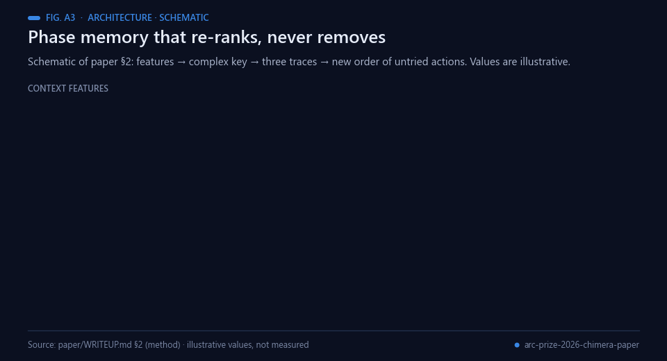 Animated figure A3 — Schematic of the memory in paper §2. Values are illustrative.

Superpose random-phase context features, update signed EFFECT, GOAL and DEADLY traces on transitions, and re-rank untried actions without excluding them; evaluate against the same graph explorer.

## Measured evidence and baselines

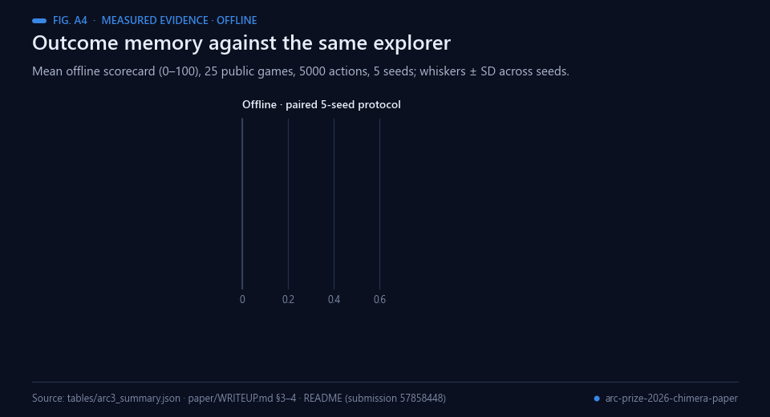 Animated figure A4 — Offline protocol and official score, kept apart. Data: tables/arc3_summary.json and the table in paper §4.

Reported 25-game offline control 0.147 versus CHIMERA 0.422 (five-seed protocol). Kaggle ARC3 submission 57858448 COMPLETE scored 0.26 public. Offline and official metrics are different and must not be conflated.

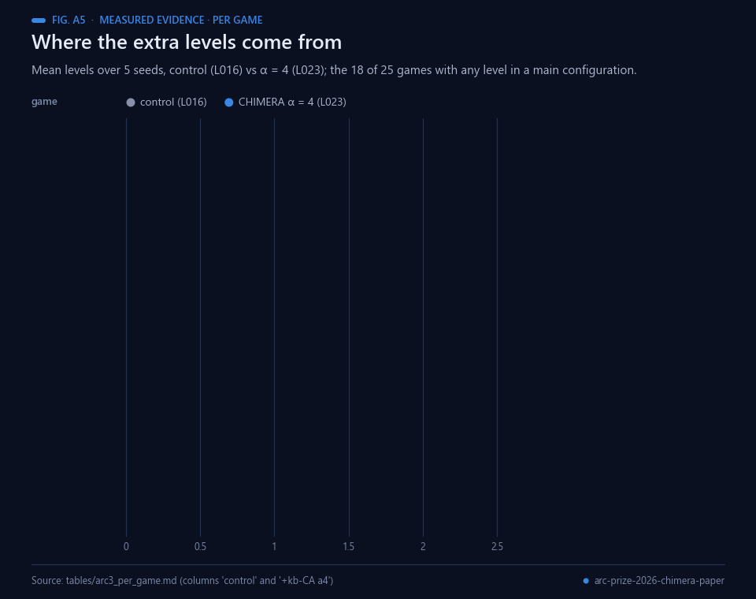 Animated figure A5 — Levels per game. Data: tables/arc3_per_game.md.

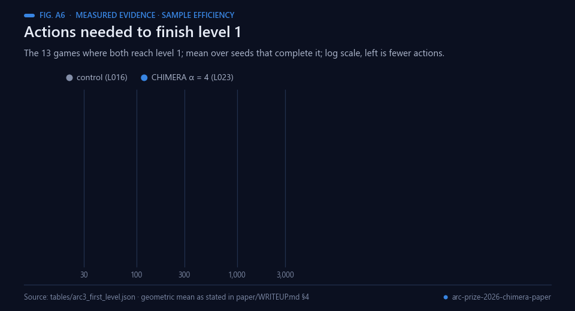 Animated figure A6 — Sample efficiency on the 13 games both solve. Data: tables/arc3_first_level.json.

The result above is deliberately phase-labelled. Any held-out competition rank not independently verified remains unknown.

## Reproducibility and source provenance

The following original research files were copied from the owner's local competition workspace on 1 November 2026, without modifying original files:

- paper/WRITEUP.md
- scripts/analyze.py
- scripts/cover.py
- tables/arc3_summary.json
- tables/arc3_first_level.json
- tables/arc3_per_game.md
- tables/arc2_e005_score_copy.json
- figs/cover.png
- figs/fig1_scores.png
- figs/fig2_levels_per_game.png
- figs/fig3_first_level_actions.png

This release intentionally excludes unauthorized organizer data, personal records, signed forms, credentials, external weights and third-party corpora. Install the project's stated dependencies and acquire the authorized input data before running experimental pipelines. The GitHub Actions workflow verifies syntax and regenerates the conceptual animation; it does not claim to reproduce the official challenge evaluation.

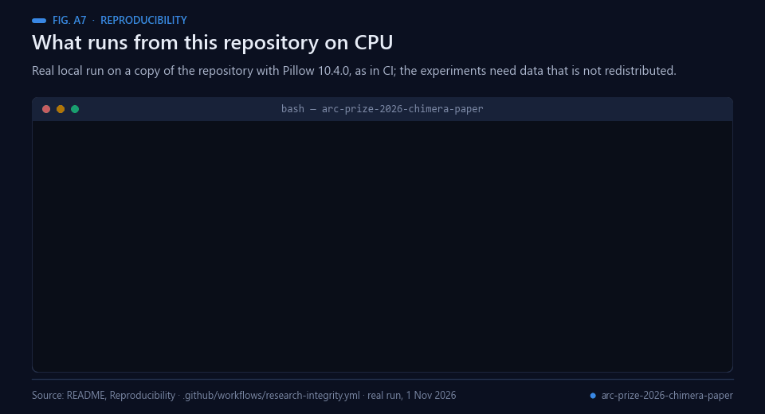 Animated figure A7 — A real local run on a copy of this repository (1 Nov 2026).

To regenerate the animation: install Python 3.11+ and Pillow 10.4.0, then run python scripts/generate_workflow_visual.py.

## Experimental controls and limitations

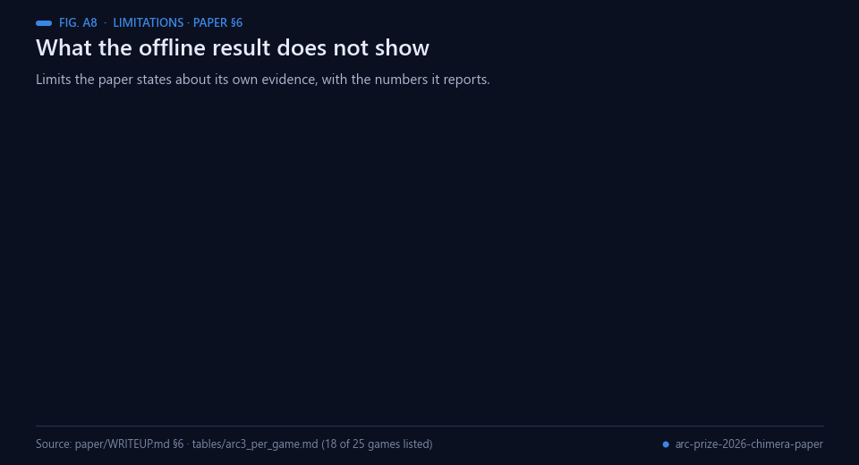 Animated figure A8 — Limits stated in paper §6, with the numbers it reports.

Paper release is not proof of Kaggle Paper Track submission. Related ARC3 source uses MIT; organizer cites public-domain-style CC0/MIT-0, which needs explicit copyright-owner resolution for prize eligibility.

A prepared archive or notebook is not evidence of an official submission. Keep public, private, warm-up and local scores distinct, and preserve baseline and ablation failures.

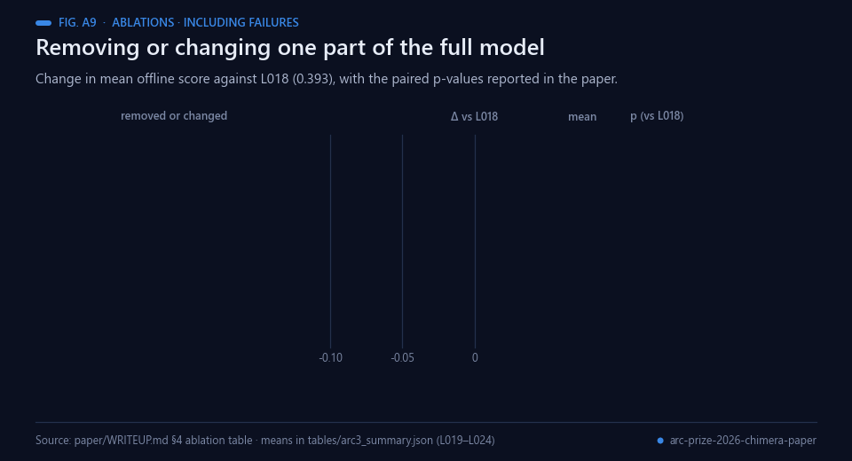 Animated figure A9 — Ablations, including the ones that lose score. Data: paper §4 and tables/arc3_summary.json.

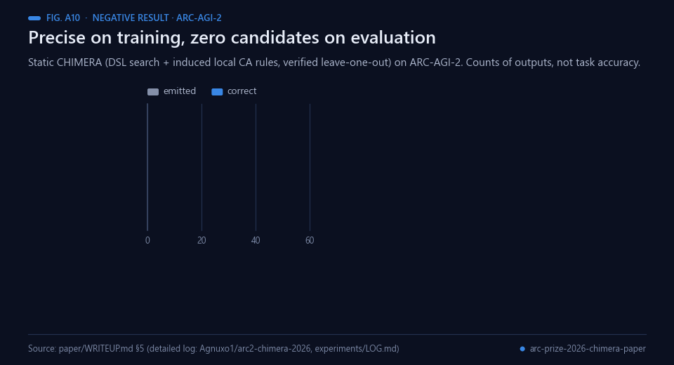 Animated figure A10 — The negative result on ARC-AGI-2 reported in paper §5.

## Real-world applications

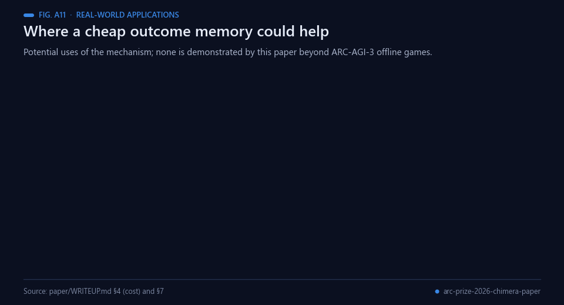 Animated figure A11 — Potential uses of the mechanism. None is demonstrated beyond ARC-AGI-3 offline games.

These are possible uses, not results; each would need its own paired evaluation.

- **Ranking prior for other agents.** The paper expects the memory to work as an action-ranking prior for
  other exploration agents, including LLM-driven ones, and states that this is untested.
- **Interface and game testing.** Software and game interfaces where an action's effect is local and repeats
  across screens have the structure the local features capture.
- **CPU-only agents.** The paper reports 3.0 ms per action against 1.3 ms for the control, with no GPU,
  training data or language model.
- **Avoiding known traps.** The DEADLY trace stores actions that ended a game, so they can be postponed
  rather than repeated first; candidates are re-ordered, never removed.
- **Evaluation practice.** A paired control, five seeds, a signed-rank test [[11](#ref-11)] and ablations reported
  with their failures are reusable for other agent studies.
- **Teaching.** The memory is a compact worked example of holographic reduced representations [[8](#ref-8)]
  trained with the delta rule [[10](#ref-10)].

## Possible improvements

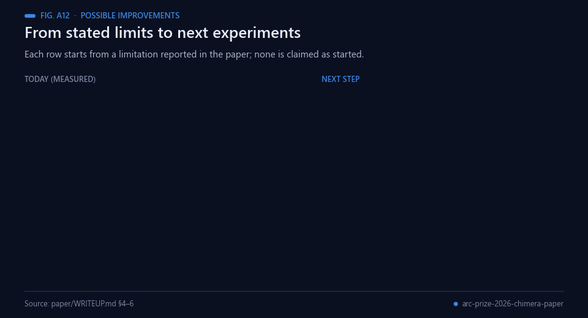 Animated figure A12 — Each row starts from a limitation the paper reports. None is claimed as started.

- **Isolate the EFFECT trace.** No ablation removes it alone, so its contribution is not identified; an
  EFFECT-only ablation on the same 25 games and seeds would settle it.
- **Test the simpler baseline the paper names.** The memory is a linear model on random features and a hashed
  linear model might match it; that baseline at equal budget against L023 is the direct test.
- **Reduce seed variance.** With α = 4, seed 0 scores 0.73 and seed 1 0.18; more phase projections per game,
  with the per-seed spread reported, would show how much of the gain is stable.
- **Match the official budget.** The offline protocol uses 5000 actions, fewer than the Kaggle run; repeating
  the paired protocol at the Kaggle budget would make the two settings easier to relate, though still not
  comparable as scores.
- **Test the interaction-data hypothesis directly.** On ARC-AGI-2 the static version emits 0 candidates on 172
  evaluation outputs; the hypothesis that local rules need interaction data is so far drawn from a contrast,
  not from a controlled test.

## Future work

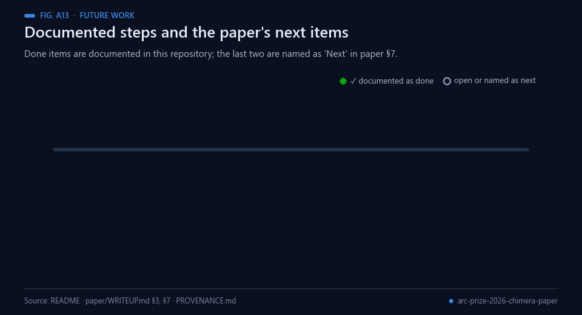 Animated figure A13 — Documented steps, the open Paper Track status and the two items paper §7 names as next.

Documented in this repository:

1. The paired offline protocol: control, CHIMERA and six variants (L016–L024), 25 public games, 5 seeds,
   in [`tables/arc3_summary.json`](tables/arc3_summary.json).
2. Kaggle ARC3 submission 57858448, COMPLETE, 0.26 public.
3. This paper draft, [`paper/WRITEUP.md`](paper/WRITEUP.md). The official Kaggle Paper Track entry is NOT
   verified.

Named as next in the paper (§7): object-centric features, and GOAL traces for planning.

**Proposed next steps (not commitments).** These are suggestions from this README build, not the author's
published plan: an EFFECT-only ablation; a hashed linear baseline at equal budget; more phase projections per
game; the paired protocol at the Kaggle action budget; and a controlled test of whether local rules need
interaction data.

## Licenses, references, and AI use

Third-party components retain their upstream licenses; no previously unlicensed source is relicensed by this publication. Licensing of newly curated material is subject to rights review. Competition official URL is linked above. AI assistance was used to produce factual English documentation and conceptual visuals; experimental metrics were not generated.

[Evidence and source manifest](PROVENANCE.md).

## Full scientific manuscript

[Read paper](paper/WRITEUP.md). Publication here is not an official Kaggle Paper Track submission.

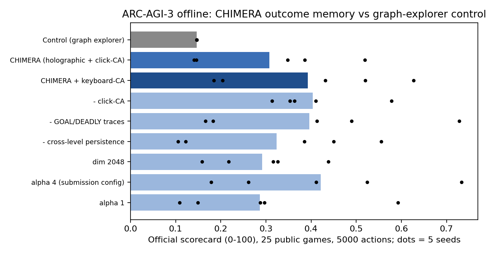

## Bibliography

1. Chollet, F. (2019). On the Measure of Intelligence. *arXiv* 1911.01547. https://arxiv.org/abs/1911.01547
2. Chollet, F., Knoop, M., Kamradt, G., & Landers, B. (2024). ARC Prize 2024: Technical Report. *arXiv* 2412.04604. https://arxiv.org/abs/2412.04604
3. Chollet, F., Knoop, M., Kamradt, G., Landers, B., & Pinkard, H. (2025). ARC-AGI-2: A New Challenge for Frontier AI Reasoning Systems. *arXiv* 2505.11831. https://arxiv.org/abs/2505.11831
4. Chollet, F., Knoop, M., Kamradt, G., & Landers, B. (2026). ARC Prize 2025: Technical Report. *arXiv* 2601.10904. https://arxiv.org/abs/2601.10904
5. ARC Prize Foundation. *ARC-AGI-3: interactive reasoning benchmark* (website). https://arcprize.org/arc-agi/3/
6. ARC Prize Foundation (2026). *ARC Prize 2026: Paper Track* (competition). https://arcprize.org/competitions/2026/paper
7. ARC Prize Foundation & Kaggle (2026). *ARC Prize 2026: ARC-AGI-3* (competition). https://www.kaggle.com/competitions/arc-prize-2026-arc-agi-3
8. Plate, T.A. (1995). Holographic reduced representations. *IEEE Transactions on Neural Networks*, 6(3), 623–641. https://doi.org/10.1109/72.377968
9. Kanerva, P. (2009). Hyperdimensional Computing: An Introduction to Computing in Distributed Representation with High-Dimensional Random Vectors. *Cognitive Computation*, 1(2), 139–159. https://doi.org/10.1007/s12559-009-9009-8
10. Widrow, B., & Hoff, M. E. (1960). Adaptive switching circuits. *IRE WESCON Convention Record*, Part 4, 96–104 (Stanford Electronics Laboratories report, Defense Technical Information Center). https://doi.org/10.21236/AD0241531
11. Wilcoxon, F. (1945). Individual comparisons by ranking methods. *Biometrics Bulletin*, 1(6), 80–83. https://doi.org/10.2307/3001968
12. Wolfram, S. (1983). Statistical mechanics of cellular automata. *Reviews of Modern Physics*, 55(3), 601–644. https://doi.org/10.1103/RevModPhys.55.601
13. Bellemare, M. G., Srinivasan, S., Ostrovski, G., et al. (2016). Unifying Count-Based Exploration and Intrinsic Motivation. *arXiv* 1606.01868. https://arxiv.org/abs/1606.01868
14. Ecoffet, A., Huizinga, J., Lehman, J., Stanley, K. O., & Clune, J. (2021). First return, then explore. *Nature*, 590(7847), 580–586. https://doi.org/10.1038/s41586-020-03157-9
15. Angulo de Lafuente, F. (2026). *arc3-chimera-explorer: CHIMERA outcome memory for ARC-AGI-3* (software). https://github.com/Agnuxo1/arc3-chimera-explorer
16. Angulo de Lafuente, F. (2026). *arc2-chimera-2026: verified symbolic candidates for ARC-AGI-2* (software). https://github.com/Agnuxo1/arc2-chimera-2026
17. Angulo de Lafuente, F. *ARC2_CHIMERA: research proof-of-concept for ARC-AGI* (software). https://github.com/Agnuxo1/ARC2_CHIMERA

---

Built by <a href="https://github.com/Agnuxo1">Francisco Angulo de Lafuente</a> · every animated figure
renders the file or the real run named in its footer, or says it is schematic or illustrative ·
<a href="#arc-prize-2026-paper-holographic-outcome-memory">back to top ↑</a>

